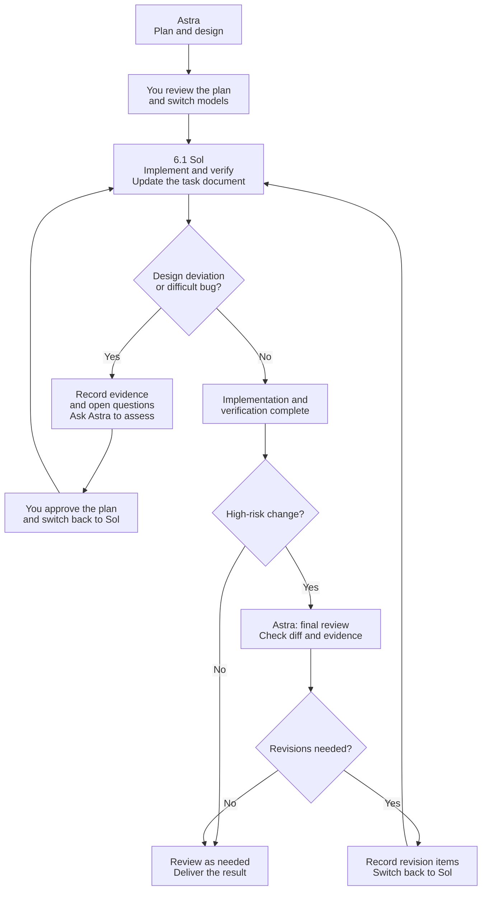

# plan-handoff

[Chinese README](README.zh-CN.md)

A lightweight Agent Skill for **manual model handoffs, readable task summaries, and recoverable plan cleanup**. Each task keeps one dedicated plan.md throughout planning, implementation and review.

This project started with a practical frustration: running an entire development workflow with Astra and Superpowers made even a Pro allowance feel tight. We wanted to reserve the higher-cost model for important decisions and let a more economical model handle the implementation work.

plan-handoff turns that division into a resumable plan. For example, let Astra plan, then manually switch to 6.1 Sol for implementation. If implementation calls for a significant design deviation or encounters a hard-to-diagnose problem, record the evidence and open questions, then manually switch back to Astra for a decision. For high-risk changes, return to Astra for a final review after implementation and verification. You can still use Superpowers for planning or debugging; this independent skill handles the handoff.

A manual relay needs no automatic subagent dispatch, avoiding the extra agent contexts, task distribution, and report aggregation that such orchestration would introduce. The task document carries scope, key decisions, progress, and verification evidence; source files and logs are read as needed. You choose the models and when to switch.

**Put the reasoning where it matters. Make the budget count.**

This example uses Astra and 6.1 Sol. You make every model switch manually:



## Three modes

`plan-handoff` stays one installed skill. These names select its modes; they are not separate skills or registered slash commands.

| Mode | Purpose |
| --- | --- |
| **plan-switch** (default) | Plan, implement, resume, decide and review with an explicit next-stage/model-role handoff |
| **plan-summary** | Maintain one readable overview of inactive tasks: what was delivered, validation, limits and current position |
| **plan-clean** | Archive summary-covered inactive plan files into recoverable ZIPs under the collection's `archive/` |

```text
Use $plan-handoff in plan-summary mode for handoffs/. Preserve active plans.
Use $plan-handoff in plan-clean mode. Preview covered candidates before archiving.
```

Summary uses task status and remaining work, not file age. In-progress, blocked, pending acceptance/review and unknown tasks remain protected. The overview may show brief active-task snapshots without compressing their execution context. Cancelled and superseded proposals are not reported as implemented features.

Cleanup requires current summary coverage. If no valid summary exists, the agent asks whether to summarize first unless you already authorized the complete chain. The local helper previews exact paths, checks links in the declared scope, verifies a ZIP before removing originals, preserves evidence files, and supports restoration into a new directory. It cannot judge semantic summary quality or grant authorization.

The collection keeps one `summary.md`, one `summary.manifest.json`, an optional navigation index, active task folders and `archive/YYYY-MM-DD-NNN.zip`. Repeated summary updates preserve archived results; archive files are excluded from ordinary plan scans. See [summary rules](references/plan-summary.md) and [cleanup and recovery](references/plan-clean.md).

## How to use

1. Ask the agent to use `plan-handoff` to plan a task. It examines the relevant project context and writes a concise plan, without implementing the change.
2. Review the plan and manually select the implementation model.
3. Ask the agent to read that plan and implement it. It checks the workspace, continues authorized work, and records verification results.
4. For significant design deviations or hard-to-diagnose problems, update the task document with evidence and open questions, then manually return to the planning model for a decision before continuing.
5. For high-risk changes, manually return to the planning model for a final review after implementation and verification. The reviewer checks changes and evidence against the plan; review other changes as needed.

Example prompts in Codex after installation:

```text
Use $plan-handoff to plan adding CSV export. Save the task document to
handoffs/2026-10-29-csv-export/plan.md. Plan only; I will switch models before implementation.

[After switching models]
Use $plan-handoff to implement handoffs/2026-10-29-csv-export/plan.md.
```

The same conversation and a fresh conversation can both use the task file. New sessions need access to the project, plan, and applicable instructions. Invocation syntax depends on the host.

## Installation

Put this folder in your client's skill directory under the name `plan-handoff`. Keep the repository folder intact, including [SKILL.md](SKILL.md), [references](references/plan-switch.md), [templates/plan.md](templates/plan.md), [templates/summary.md](templates/summary.md) and [scripts/plan_store.py](scripts/plan_store.py). Skill instructions, discovery and display metadata, and the task template are in English. A Chinese README is available separately.

For Codex, a user-level location is `~/.agents/skills/plan-handoff`. Once you have downloaded or cloned the repository, you can copy its files there. For a development checkout on Linux or macOS, an alternative is a symbolic link:

```sh
# Replace the source path with your actual checkout. The target must not exist.
mkdir -p "$HOME/.agents/skills"
ln -s /absolute/path/to/plan-handoff "$HOME/.agents/skills/plan-handoff"
```

Restart or refresh the client if it does not discover the skill. For other clients, follow their skill installation instructions. You can also explicitly ask an agent to read `SKILL.md` from your checkout without installing it.

When upgrading from v0.1.0, update the complete skill folder: v0.2.0 adds mode references, a summary template and the optional cleanup helper. Existing task plans keep their paths and do not require automatic migration. A symlink installation follows its source checkout; copied installations need the new files copied over. Reload the skill in an existing conversation if it already loaded older instructions. See [the changelog](CHANGELOG.md).

[agents/openai.yaml](agents/openai.yaml) supplies optional Codex display metadata. The workflow does not depend on it. Other hosts may ignore or omit it; format portability does not establish tested integration with every client.

## What belongs in the task document

Each task gets one dedicated `plan.md`, using the [plan template](templates/plan.md). Existing user plans, notes, and handoffs are reference sources; the skill does not rewrite them as progress logs unless explicitly asked. Record scope, baseline, decisions, acceptance criteria, current state, and the next handoff. Reference source and logs instead of copying them.

By default, create `handoffs/YYYY-MM-DD-<topic>/plan.md` in the target project. Different tasks use different folders; the filename stays `plan.md`. Honor a user-designated location and keep existing dedicated plans at their current paths, including legacy paths.

| Situation | What happens |
| --- | --- |
| Switch model or conversation, resume another day, implement, or review | Update the same plan |
| Revise the approach or fix acceptance failures within the same goal | Update the same plan and preserve important decision changes |
| Add an independently deliverable goal or subtask | Create a linked plan in a new task folder |
| Replace the goal entirely | Create a successor and mark the old plan superseded, not completed |
| Discover incomplete work behind a completion claim | Reopen the original plan and mark invalid evidence |
| The document becomes long | Consolidate current state; do not create another version just for length |

Update progress in place and keep concise decision history. Completed plans stay at stable paths by default; an explicitly requested plan-clean may archive them after coverage and dependency checks. With multiple tasks, use one lightweight collection index (normally `handoffs/index.md`) for links, goal summaries, and statuses; detailed state stays in each plan. Small tasks can combine template sections.

## Handoff prompts

At each actual handoff, the agent updates the plan and prominently displays the current state/authorization, **next stage**, **required model role**, manual action and exact plan path. The copyable prompt repeats the next stage and role so it stays clear in a new conversation. It uses your model preferences, or generic roles if none are known:

```text
Next stage: Implementation
Required model role: Implementation model (your preference: 6.1 Sol)
Manual action: Select that model; if already selected, no switch is needed.

Use $plan-handoff in plan-switch mode. Next stage: [Implementation].
Required role: [Implementation model]. Read <exact plan path>, check the
workspace, implement the confirmed scope, verify, and update the same plan.
```

- **Ready to implement:** suggest a more economical implementation model; the prompt asks it to check the workspace, implement the confirmed scope, verify it, and update the same plan. Any pending approval is stated explicitly.
- **Decision needed:** suggest returning to the planning model; the prompt points to the specific question, evidence, attempted approaches, and options. It asks for a decision, not unauthorized implementation.
- **Review requested or recommended for high risk:** suggest a review model; the prompt asks it to inspect changes and evidence and record findings without editing implementation files.

Planning completion does not grant execution permission. Ordinary implementation steps do not repeatedly ask you to switch, and a review recommendation does not start another model call.

## Scope and validation

Ordinary plan-switch uses instructions and templates. Summary coverage and recoverable cleanup optionally use Python 3.9+ and the standard-library helper; no pip installation is needed. If the helper cannot run, originals are retained. The skill makes no model/API calls, installs no hooks and has no automatic routing or required companion skill. Instructions and hashes do not establish semantic correctness or authorization.

The v0.2.0 helper passed 34 temporary-fixture tests on each of Linux Python 3.9 and 3.13. Review reran all 34 from a verified source snapshot and checked three additional boundary scenarios. Coverage includes protected task status, stale summaries, partial removal failures, scoped references, LF/CRLF and byte-exact restoration. Format/link checks and review of explicit handoff instructions also passed. See [design and validation notes](DESIGN.md) for scope and reproduction commands.

Fresh-session model behavior, native Windows execution, other client integrations and cost savings remain unmeasured. The helper requires coordinated writers and checks references only within the declared scope and supported syntax. No token or cost reduction is claimed.

## Contributing

Report a concrete situation, expected behavior, and observed behavior. Prefer a small example and redact private project data. Changes should keep the core short, preserve user authorization, and avoid adding dependencies without a demonstrated need.

## Related work

The design discussion considered [Planning with Files](https://github.com/OthmanAdi/planning-with-files), [handoff-skill](https://github.com/ToolMonsters/handoff-skill), [OpenSpec](https://github.com/Fission-AI/OpenSpec), and [Spec Kit](https://github.com/github/spec-kit). They are references, not bundled dependencies.

## License

[MIT](LICENSE).
