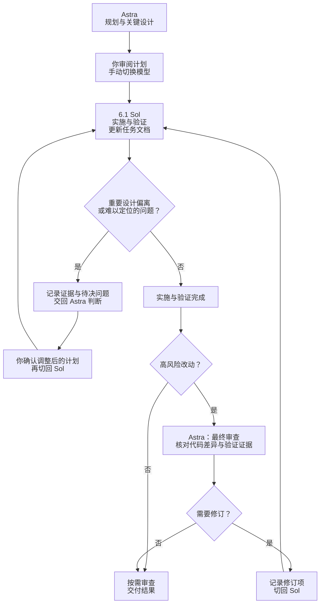

# plan-handoff · 规划与实施交接

[English](README.md)

一个轻量 Agent Skill：**手动模型交接、任务成果归纳与可恢复的计划清理。** 每个任务从规划、实施到审查，持续使用同一份 plan.md。

这个项目起于一个实际烦恼：用 Astra 配合 Superpowers 跑完整个开发流程，即使订阅了 Pro，也觉得额度消耗得太快。我们希望把高成本模型留给关键决策，让更经济的模型接手大量实施工作。

plan-handoff 把这个分工变成一份可接续的计划：例如让 Astra 规划，手动切到 6.1 Sol 实施；实施中涉及重要设计偏离，或遇到难以定位的问题时，记录现有证据与待决问题，再手动切回 Astra 判断。高风险改动则在实施和验证完成后交由 Astra 做最终审查。Superpowers 可以继续用于你需要的规划或调试环节，交接本身由这个独立 Skill 完成。

手动接力无需自动派遣子代理，省去为交接额外建立代理上下文、分派任务和汇总回报的环节。任务文档只传递范围、关键决策、进度和验收依据，源码与日志按需读取。模型组合和切换时机都由你决定。

**把聪明用在关键处，做个精打细算的“能工智人”。**

以下以 Astra 与 6.1 Sol 为例；所有模型切换均由你手动完成：



## 三个模式

`plan-handoff` 仍是一个已安装的 Skill。以下名称是模式，不是另外三个 Skill 或客户端斜杠命令。

| 模式 | 用途 |
| --- | --- |
| **plan-switch**（默认） | 规划、实施、恢复、决策与审查接力，明确下一阶段和模型角色 |
| **plan-summary** | 维护一份易读的旧任务成果总览：实现了什么、验证范围、限制和当前进度 |
| **plan-clean** | 将已被有效摘要覆盖的旧计划压缩至本目录 `archive/`，可恢复 |

```text
使用 $plan-handoff，对 handoffs/ 执行 plan-summary，保留活跃计划。
使用 $plan-handoff，执行 plan-clean，先预览已覆盖候选再归档。
```

summary 看任务状态与剩余工作，不按文件年龄判断。实施中、受阻、待验收、待审查和状态不明的计划均受保护；总览可以列出少量活跃状态，但不压缩其执行上下文。取消或被替代的方案不会被写成已实现功能。

clean 要求摘要覆盖仍然有效；没有有效 summary 时先询问是否执行，除非你已经授权完整链路。辅助工具预览明确路径、核对指定范围内的引用，先验证 ZIP 再移除原文，保留证据文件，并支持恢复到全新目录。摘要的语义质量和操作授权仍需由模型与用户核对。

目录只维护一份 `summary.md`、一份 `summary.manifest.json`、可选导航索引、活跃任务目录及 `archive/日期-序号.zip`。重复摘要保留已有归档成果，普通扫描跳过 archive/。详见[摘要规则](references/plan-summary.md)与[清理及恢复](references/plan-clean.md)。

## 使用方式

1. 要求使用 `plan-handoff` 规划任务；模型读取必要上下文，写出计划，在实施前结束规划阶段。
2. 审阅计划，手动切换到实施模型。
3. 要求按计划实施；模型核对工作区后接续工作，记录实际验证结果。
4. 遇到重要设计偏离或难以定位的问题，先更新任务文档中的证据和待决问题，再手动切回规划模型判断；明确后继续实施。
5. 高风险改动在实施和验证完成后，手动切回规划模型做最终审查，核对差异和验收依据；其他改动按需审查。

Codex 安装后的示例：

```text
使用 $plan-handoff，先规划 CSV 导出功能，将任务文档写入
handoffs/2026-10-29-csv-export/plan.md。只做规划，之后我会切换模型实施。

（手动切换模型后）
使用 $plan-handoff，按 handoffs/2026-10-29-csv-export/plan.md 实施。
```

可以在同一对话切换，也可以由新对话接手。新对话需要访问项目、计划和适用规则；具体调用语法由客户端决定。

## 安装

将本仓库文件夹放入客户端的 Skill 目录，目录名保持 `plan-handoff`，并保留完整目录，包含 [SKILL.md](SKILL.md)、[references](references/plan-switch.md)、[templates/plan.md](templates/plan.md)、[templates/summary.md](templates/summary.md) 和 [scripts/plan_store.py](scripts/plan_store.py)。技能说明、发现描述、显示名称、默认提示和任务模板统一使用英文；仅本 README 保留中文。安装后的显示名称为 `Plan Handoff`。

Codex 的用户级目录可使用 `~/.agents/skills/plan-handoff`。下载或克隆仓库后，可复制到这里。Linux／macOS 的开发工作区也可以用软链接：

```sh
# 将源路径替换为实际仓库路径；目标目录不能已存在。
mkdir -p "$HOME/.agents/skills"
ln -s /absolute/path/to/plan-handoff "$HOME/.agents/skills/plan-handoff"
```

客户端没有发现新 Skill 时，重新启动或刷新。其他客户端按其安装说明操作。也可以不安装，直接让模型读取开发目录中的 `SKILL.md`。

从 v0.1.0 升级时请更新完整 Skill 目录：v0.2.0 新增模式规则、摘要模板和可选清理工具。已有任务计划继续使用原路径，不自动迁移。软链接安装随源工作区更新；复制安装需要补齐新版文件。已有对话若加载过旧说明，请重新读取 Skill。版本变化见[变更记录](CHANGELOG.md)。

[agents/openai.yaml](agents/openai.yaml) 仅提供可选 Codex 显示信息，通用流程不依赖它。其他客户端可以忽略或省略这个文件；格式通用不代表所有客户端都已实测。

## 任务文档

每个任务使用一份独立的 `plan.md`，由[计划模板](templates/plan.md)创建。用户已有计划、笔记和交接资料作为引用来源，除非明确要求，否则不直接改成进度日志。记录范围、基线、决策、验收、当前状态和下一步交接；源码和日志只引用。

默认放在目标项目的 `handoffs/YYYY-MM-DD-主题/plan.md`。不同任务用文件夹区分，文件名统一为 `plan.md`；用户指定位置时遵从指定。已有专用计划继续原地使用，包括旧版路径，不自动搬迁。

| 情况 | 如何处理 |
| --- | --- |
| 换模型、换对话、隔天继续、实施或审查 | 更新同一份计划 |
| 同一目标下调整方案或修复验收失败 | 更新同一份，保留重要决策变更 |
| 新增可独立交付的目标或子任务 | 新建任务文件夹和计划，并建立关联 |
| 新目标完全替代原目标 | 新建后继计划，旧计划标记“已替代”，不冒称完成 |
| 完成后发现漏项或验收结论不成立 | 重新打开原计划，标记失效证据 |
| 文档过长 | 整理当前状态，不因长度新造一份“最新版” |

进度覆盖更新，重要决策保留简短历史；已完成计划默认原地保留，明确要求 plan-clean 后可在摘要覆盖与依赖检查通过时归档。多个任务用一个轻量索引（默认 `handoffs/index.md`）列出链接、目标摘要和状态，详情以各计划为准。小任务可以合并模板栏目。

## 交接提示

每次实际交接时，模型先更新计划，再醒目展示当前状态和授权、**下一阶段、应使用的模型角色、手动操作**及准确路径。可复制提示词也重复阶段和角色，复制到新对话后仍能看懂。优先采用你的模型偏好，未指定时只称角色：

```text
下一阶段：实施
应使用的模型角色：执行模型（你的偏好：6.1 Sol）
操作：手动选择该模型；若已经选中，无需切换。

使用 $plan-handoff 的 plan-switch 模式。下一阶段是【实施】，使用【执行模型】。
读取 <准确计划路径>，核对工作区，实施已确认范围、验证并更新同一计划。
```

- **准备实施：** 提醒手动切换到更经济的实施模型；提示词要求核对工作区、实施已确认范围、验证并更新同一份计划。有待批准的内容必须明示。
- **需要判断：** 提醒切回规划模型；提示词指向具体问题、证据、已尝试方法和选项，要求判断而非越权实施。
- **用户要求审查，或高风险改动建议审查：** 提醒切换审查模型；提示词要求核对实际差异和验收证据、记录结论，不修改实现文件。

计划写完不等于已获实施授权。普通实施步骤不会反复要求切换模型；建议审查也不会自行发起额外模型调用。

## 范围与验证

普通 plan-switch 只需指令和模板；摘要覆盖与可恢复清理可选用 Python 3.9+ 标准库辅助工具，无需安装 pip 依赖，工具无法运行时保留原文。Skill 不调用模型/API，不安装 hooks，也不自动路由或依赖其他 Skill。规则与哈希检查不等于语义正确性或操作授权。

v0.2.0 辅助工具在 Linux Python 3.9 和 3.13 下各通过 34 项临时夹具测试；复审从校验后的固定源码快照重新运行 34 项，并补查 3 个边界场景。覆盖任务状态保护、过期摘要、部分删除失败、指定范围引用、LF/CRLF 和逐字恢复；格式、链接及明确交接提示也已审校。验证范围与复现命令见[设计与验证说明](DESIGN.md)。

新对话中的模型行为、Windows 原生执行、其他客户端集成和额度节省仍未实测。使用辅助工具前须协调写入归属，引用检查仅覆盖声明范围及支持的语法。不承诺节省比例。

## 参与改进

反馈请提供具体场景、预期与实际表现，优先使用小示例并去除项目私密信息。修改应保持核心简短、遵循用户授权，仅在有实际需求时增加依赖。

## 参考项目

设计讨论参考了 [Planning with Files](https://github.com/OthmanAdi/planning-with-files)、[handoff-skill](https://github.com/ToolMonsters/handoff-skill)、[OpenSpec](https://github.com/Fission-AI/OpenSpec) 和 [Spec Kit](https://github.com/github/spec-kit)。这些是参考项目，不是打包依赖。

## 许可

[MIT](LICENSE)。
